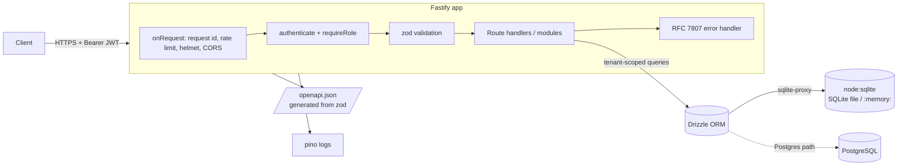

# Ledgerly API

Ledgerly is a REST API for small-business **invoicing and expenses**. It covers organizations (tenants), users with roles, customers, invoices with line items and a status machine, idempotent payments, expenses and financial reports. It is built with **Node 24, TypeScript (strict), Fastify 5, zod and Drizzle ORM**.

> Portfolio project with fictional data. **Docs site:** `docs-site/dist/index.html` (built by `npm run docs`). It includes the OpenAPI 3.1 reference (Redoc, bundled locally), a mock "Try it" console that replays responses recorded from the real API, and the test and coverage summary.

## Highlights

| Concern             | Implementation                                                                                                                                                                                                                                                                                                                       |
| ------------------- | ------------------------------------------------------------------------------------------------------------------------------------------------------------------------------------------------------------------------------------------------------------------------------------------------------------------------------------ |
| Validation and docs | zod schemas validate requests and serialize responses, and they also generate the **OpenAPI 3.1** document (`GET /openapi.json`). The docs can't drift from the code.                                                                                                                                                                |
| Auth                | bcrypt password hashes. Access JWTs last 15 minutes (HS256, `jose`, with issuer and audience checks) and carry `sub`, `org` and `role`. **Refresh tokens rotate**, are stored as SHA-256 hashes, and **re-using an old one revokes the whole token family**. Login doesn't reveal whether an email exists (same error, same timing). |
| RBAC                | `owner` / `member` roles with `requireRole()` guards. Owners manage members, delete customers and delete invoices. Members may only delete expenses they created. The last owner can't be demoted or removed.                                                                                                                        |
| Multi-tenancy       | Every query is scoped by `orgId` from the token. Other tenants' resources return **404, never 403**, so their existence isn't leaked.                                                                                                                                                                                                |
| Invoices            | Integer cents and per-line tax (basis points) with half-up rounding; totals are always computed on the server. Numbers come from an atomic per-org counter (`INV-00042`) and are never reused. Status machine: `draft → sent → partially_paid → paid`, plus `void`. Overdue is derived, not stored.                                  |
| Payments            | `Idempotency-Key` is required. The same key with the same body **replays** the stored response (`Idempotent-Replayed: true`); the same key with a different body returns **422**. Concurrent retries are serialized in one transaction. Overpayments return **409**.                                                                 |
| Errors              | One error format everywhere: **RFC 7807 `application/problem+json`** with a stable `type` URI, `requestId`, and field-level `errors[]` for validation failures.                                                                                                                                                                      |
| Ops                 | Request IDs (honours a valid incoming `X-Request-Id`), **pino** JSON logs with credentials redacted, global and per-auth-route **rate limiting**, helmet, CORS allow-list, `/health` and `/ready`, graceful shutdown, Dockerfile, Compose and CI.                                                                                    |

## Architecture



```
src/
  app.ts              buildApp(config, db?): plugins, routes, OpenAPI
  server.ts           entrypoint with graceful shutdown
  config.ts           env validation (zod); refuses the dev JWT secret in production
  db/schema.ts        Drizzle schema       db/client.ts  node:sqlite + transactions + migrator
  plugins/auth.ts     JWT, request.auth, requireRole()    plugins/errors.ts  problem+json
  lib/                money math, invoice state machine, errors, pagination helpers
  modules/            auth, members, customers, invoices, payments, expenses, reports, health
migrations/           SQL migrations (SQLite) + migrations/postgres (DDL for Postgres)
scripts/              migrate, seed, openapi, build-docs (records examples), zip-source
tests/                integration tests (app.inject) + unit tests
```

**Why `node:sqlite`?** Node 24 ships SQLite, so there's no native addon to compile in CI or Docker. Drizzle talks to it through its `sqlite-proxy` driver.

**Transactions.** node:sqlite is synchronous while the handlers are async. `db.tx()` holds an async lock for the whole `BEGIN IMMEDIATE … COMMIT`, and statements outside a transaction wait for that lock (`AsyncLocalStorage` tells the two apart). The result is serializable transactions with no interleaving between requests.

## Endpoints

| Method         | Path                             | Auth        | Notes                                                                            |
| -------------- | -------------------------------- | ----------- | -------------------------------------------------------------------------------- |
| GET            | `/health`, `/ready`              | none        | liveness / readiness (DB ping)                                                   |
| POST           | `/v1/auth/register`              | none        | creates user + organization (owner)                                              |
| POST           | `/v1/auth/login`                 | none        | optional `organizationId`                                                        |
| POST           | `/v1/auth/refresh`               | none        | rotation + reuse detection                                                       |
| POST           | `/v1/auth/logout`                | none        | revokes the token family                                                         |
| GET            | `/v1/auth/me`                    | any         | user, current org, role, all orgs                                                |
| GET / POST     | `/v1/members`                    | any / owner | add existing user or create with initial password                                |
| PATCH / DELETE | `/v1/members/:userId`            | owner       | keeps at least one owner                                                         |
| GET / POST     | `/v1/customers`                  | any         | `q`, `page`, `pageSize`, `sort=name\|-createdAt…`                                |
| GET / PATCH    | `/v1/customers/:id`              | any         |                                                                                  |
| DELETE         | `/v1/customers/:id`              | owner       | 409 if the customer has invoices                                                 |
| GET / POST     | `/v1/invoices`                   | any         | filters: `status`, `customerId`, `overdue`, `issuedFrom/To`; sort and pagination |
| GET / PATCH    | `/v1/invoices/:id`               | any         | PATCH only for drafts (replaces lines)                                           |
| POST           | `/v1/invoices/:id/send`, `/void` | any         | state machine (409 on invalid moves)                                             |
| DELETE         | `/v1/invoices/:id`               | owner       | drafts only                                                                      |
| GET / POST     | `/v1/payments`                   | any         | POST requires `Idempotency-Key`                                                  |
| GET / POST     | `/v1/expenses`                   | any         | `category`, `from`, `to`, sort                                                   |
| DELETE         | `/v1/expenses/:id`               | any         | members only delete their own                                                    |
| GET            | `/v1/reports/summary`            | any         | invoiced, collected, expenses, net, outstanding, aging                           |
| GET            | `/openapi.json`                  | none        | OpenAPI 3.1                                                                      |

## Quick start

```bash
npm install
cp .env.example .env              # optional; sensible dev defaults exist
npm run migrate                   # creates ./ledgerly.db
npm run seed -- --reset           # fictional "Northwind Studio" data
npm run dev                       # http://localhost:3000
```

### curl examples

```bash
# Register (creates an organization; you are its owner)
curl -s -X POST localhost:3000/v1/auth/register -H 'content-type: application/json' \
  -d '{"email":"you@example.com","password":"correct-horse-42","name":"You","organizationName":"Acme"}'

TOKEN=...   # tokens.accessToken from the response

# Create a customer and a draft invoice (amounts in cents; tax in basis points)
curl -s -X POST localhost:3000/v1/customers -H "authorization: Bearer $TOKEN" \
  -H 'content-type: application/json' -d '{"name":"Blue Harbor Coffee"}'
curl -s -X POST localhost:3000/v1/invoices -H "authorization: Bearer $TOKEN" -H 'content-type: application/json' \
  -d '{"customerId":"cus_...","lines":[{"description":"Design","quantity":10,"unitPriceCents":12500,"taxRateBp":825}]}'

# Finalize, then pay idempotently (safe to retry with the same key)
curl -s -X POST localhost:3000/v1/invoices/inv_.../send -H "authorization: Bearer $TOKEN"
curl -s -X POST localhost:3000/v1/payments -H "authorization: Bearer $TOKEN" \
  -H 'Idempotency-Key: pay-2026-0001' -H 'content-type: application/json' \
  -d '{"invoiceId":"inv_...","amountCents":50000,"method":"bank_transfer"}'

# Financial summary
curl -s "localhost:3000/v1/reports/summary?from=2026-01-01&to=2026-12-31" -H "authorization: Bearer $TOKEN"
```

Error example (`400 application/problem+json`):

```json
{
  "type": "https://ledgerly.example/problems/validation-error",
  "title": "Validation failed",
  "status": 400,
  "detail": "The request contains invalid fields.",
  "errors": [{ "path": "body.email", "message": "Invalid email" }],
  "instance": "/v1/customers",
  "requestId": "3f0c6c0e-..."
}
```

## Testing

```bash
npm test                 # Vitest
npm run coverage         # + v8 coverage
npm run lint && npm run typecheck && npm run build
```

There are 33 tests in 4 files. The integration tests go through the real HTTP stack (`app.inject`), and every test file gets a **fresh, migrated in-memory SQLite database**. They cover:

- **Auth:** registration; duplicate email; validation errors; uniform 401s; refresh rotation and reuse detection; logout; tampered tokens.
- **Platform:** probes; request-ID propagation; 404 and malformed JSON as problem+json; auth rate limiting (429).
- **RBAC:** owner-only actions; the last-owner rule; members' own expenses.
- **Tenant isolation:** 404 across organizations; no references to another tenant's customers; no payments to another tenant's invoices.
- **Invoices:** rounding and tax maths; validation; the status machine; draft deletion and number gaps; pagination, filtering and sorting; overdue invoices.
- **Payments:** missing `Idempotency-Key`; replays; concurrent retries; key reuse returning 422; partial → paid; overpayment; paying a draft.
- **Reports:** totals and aging.
- **Unit:** money maths, the state machine, aging buckets, request fingerprints, production config guard, OpenAPI generation.

Coverage is about 95% of statements and lines (see the docs site for the breakdown).

## Running on Postgres

The model is portable: integer cents, text IDs and ISO dates. `migrations/postgres/0001_init.sql` holds the equivalent PostgreSQL DDL, and `docker-compose.yml` provisions Postgres with it. To switch the runtime:

1. Add `pg` and `drizzle-orm/node-postgres`.
2. Mirror `src/db/schema.ts` with `drizzle-orm/pg-core` (identical column names).
3. Replace `openDatabase()` with a `pg` Pool and use `db.transaction()` instead of the SQLite lock.

The routes don't change, because they only use the Drizzle query builder.

## Docker

The Dockerfile and Compose file are included but were not executed here.

```bash
docker compose up --build        # API on :3000 (SQLite volume) + Postgres 16 on :5432
```

---

Built by [Rafael Carvalho](https://rafaelcarvalho.dev).
